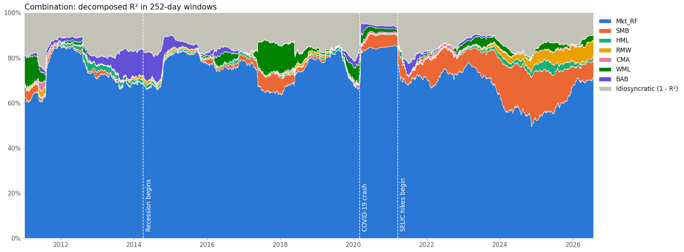

# Orthogonal Factors in Brazil

Decomposition of the systematic risk of Brazilian equity portfolios into seven local factors, with the orthogonalization of Klein and Chow (2013), from January 2010 to July 2026.

Equity factors are correlated, so the systematic variance of a portfolio has cross terms and cannot be split by factor. Klein and Chow transform the factors into uncorrelated versions that stay as close as possible to the originals, and then the variance splits exactly into one share per factor. This repository first replicates the paper with US data, then applies the method to the seven local factors, the multi-factor strategy and the 32 screening factors of the companion repository, [brazil-equity-factors](https://github.com/pedroandion/brazil-equity-factors), and to each stock of its universe, and it uses the decomposition to hedge the factor exposures of the strategies.

**Paper:** Klein, R. F. and Chow, V. K. (2013), *Orthogonalized factors and systematic risk decomposition*, The Quarterly Review of Economics and Finance 53, 175–187, [doi:10.1016/j.qref.2013.02.003](https://doi.org/10.1016/j.qref.2013.02.003).



## Results

All results are before transaction costs.

### Replication of the paper (`01_paper_replication.ipynb`)

The replication uses the same factors (market, size, value, momentum and long-term reversal), sample (1931 to 2008) and portfolios as the paper, with the current Ken French data.

- **Decomposition.** The decomposed R² of the 36 style portfolios of Table 6 is within 1.4 points of the published values in every cell, and within 0.5 point on average. The averages are the paper's: for small caps, 53% of the variance comes from the market and 24% from size; for large caps, 78% from the market.
- **Resemblance.** The orthogonal factors keep correlations of 0.91 to 0.97 with the originals, as in the paper. In the pairwise comparison of Table 1 the lowest correlation is 0.938 for SW/L, against 0.434 for PCA and 0.764 for Gram-Schmidt (0.945, 0.450 and 0.787 in the paper).
- **Differences.** The library has revised its data since 2012. The largest gap is the value-weighted Coal industry; without it, every component of the 30 industries is within 3 points of the paper.

### The local factors and BAB (`02_brazil_factors.ipynb`)

- **BAB.** The companion's BAB is long the 30% lowest-beta stocks and short the 30% highest-beta ones, one real each. Since the two legs have betas of 0.60 and 1.45 on the market, that factor has a market beta of −0.86, and the market explains 57% of its variance. This repository scales each leg by the inverse of its ex-ante beta, as Frazzini and Pedersen (2014) do, which cuts the market beta to −0.37 and the R² to 21%.
- **Multicollinearity.** With the companion's BAB, BAB had the largest variance inflation factor of the seven factors, 4.1, which led an earlier six-factor model to drop it. With the beta-neutral BAB it falls to 1.8. The most connected factor is now value, with correlations of −0.69 with momentum and −0.62 with BAB.
- **Resemblance.** The orthogonal factors keep correlations of 0.81 (HML) to 0.95 (the market) with the originals, lower than in the US because the Brazilian factors overlap more.

### The multi-factor strategy (`03_strategy_decomposition.ipynb`)

The Combination holds up to 30 stocks, 10 from each of the Magic Formula, LowVol Momentum and Quality. Share of the monthly variance of the returns in excess of the SELIC rate explained by each orthogonal factor, February 2010 to June 2026 (Quality holds stocks from February 2011):

| Strategy | Market | SMB | HML | RMW | CMA | WML | BAB | Idiosyncratic |
|---|---|---|---|---|---|---|---|---|
| **Combination** | **70.2%** | **11.9%** | **0.5%** | **1.9%** | **0.1%** | **0.2%** | **0.6%** | **14.5%** |
| Magic Formula | 58.0% | 12.3% | 0.0% | 1.9% | 0.5% | 0.5% | 1.7% | 24.9% |
| LowVol Momentum | 63.0% | 6.6% | 0.3% | 1.2% | 0.0% | 4.6% | 1.7% | 22.6% |
| Quality | 58.8% | 10.5% | 1.9% | 1.6% | 0.0% | 2.0% | 0.1% | 25.1% |

- **Sources.** The market explains most of the variance of every strategy, and size comes second. The other five factors together explain 3% to 8%, with momentum the largest of them for LowVol Momentum.
- **Why orthogonalize.** Adding up the factor terms without the transformation overstates the systematic variance of the Combination by 26%, because the strategies have positive betas on factors that move against each other, such as the market and BAB. Gram-Schmidt, the usual alternative, depends on the order of the factors: across the 5,040 orders, the market explains anywhere from 48% to 75% of the Combination, and size from 2% to 24%.
- **BAB construction.** With the dollar-neutral BAB of the companion, BAB seemed to be the third source of risk, with up to 11% of the variance of Quality. Most of that was market risk: with the beta-neutral BAB, its share is at most 1.7%, and the market's is 4 to 8 points higher.
- **Alpha.** The alpha is the same with the original and the orthogonal factors: 0.34% a month for the Combination, with a Newey-West t-statistic of 2.2, significant at 5% in this sample.

### Over time (`04_time_varying.ipynb`)

- In 60-month windows, the market explains 60% to 78% of the variance of the Combination. The second source moved from BAB, with 10% in 2010–2015, to size, with 13% in 2021–2026.
- In 252-day windows, size explained 20% in 2024, when the share of the market fell to 56%. The lowest idiosyncratic share, 4.2%, is in the window that ends during the COVID-19 crash.

### The screening factors (`05_screening_factors.ipynb`)

- The seven factors explain 96% of the companion's dollar-neutral BAB, but 29% of it goes to the orthogonal market: that is the market exposure of the construction. Low volatility splits among size, BAB and the market, and investment (CMA) explains 42% of accruals.
- The leverage factors are the least explained group: 79% of their variance is idiosyncratic. Low debt to assets has the largest alpha on the seven factors, 7.5% a year with a t-statistic of 3.3, and it is the only one of 30 alphas that passes a Bonferroni correction at 5%.

### The stocks (`06_stock_cross_section.ipynb`)

- For the average stock, the seven factors explain about a third of the daily variance: 24% from the market, 4% from size, 3% from momentum and 2% from BAB, with 63% idiosyncratic. In 2020 the share of the market rose to 50%.
- The large banks are the most explained stocks, and exporters such as Suzano, Minerva, SLC Agrícola and Embraer the least, with 77% to 85% of their variance idiosyncratic.

### Hedging the strategies (`07_factor_hedge.ipynb`)

At each monthly rebalance, the betas of the portfolio are the weighted average of the betas of the stocks it is about to hold, each from a regression of the stock's daily returns on the seven factors over the previous year. The hedge sells those betas of each factor per real in the portfolio and keeps the positions until the next rebalance. Combination, January 2012 to June 2026, total returns before costs; the SELIC rate earned 9.8% a year:

| Hedge | Total return a year | Volatility | Sharpe ratio | Maximum drawdown | Correlation with the market |
|---|---|---|---|---|---|
| None | 14.3% | 19.1% | 0.31 | −36.3% | 0.85 |
| Index only | 14.6% | 9.7% | 0.50 | −11.2% | 0.19 |
| All seven factors | 12.7% | 7.1% | 0.42 | −6.8% | 0.13 |

- **Index.** Selling the Ibovespa, 0.70 per real on average, halves the volatility of the Combination, cuts its maximum drawdown to −11% and raises its Sharpe ratio from 0.31 to 0.50, with a slightly higher total return. For the three sleeves it cuts the volatility by more than a third and raises the Sharpe ratio.
- **All seven factors.** The full hedge keeps an excess return of 3.0% a year, half that of the unhedged Combination, with a volatility of 7.1%. So much of the alpha of 0.34% a month measured with hindsight in `03_` survives when the betas come only from past data. Quality is the exception, with 1.4% a year left.
- **Holdings or past returns.** Betas from the strategy's own previous 36 monthly returns make a worse full hedge: on the months both cover, from February 2013, they leave the Combination a Sharpe ratio of 0.07, against 0.34 with the holdings, and remove 82% of its variance, against 87%.
- **Risk budget.** Out of sample, the full hedge removes 86.1% of the monthly variance of the Combination, against an R² of 86.3% in sample over the same months.

## Method

- **Transformation.** With $\Sigma$ the sample covariance matrix of the factors and $\sigma$ their standard deviations, the orthogonal factors are $F^\perp = F S$ with $S = \Sigma^{-1/2}\,\mathrm{diag}(\sigma)$. They are uncorrelated, keep the variances of the original factors and do not depend on the order of the factors. The betas become $\beta^\perp = \Psi\beta$ with $\Psi = S^{-1}$, and the intercept, the residuals and the R² do not change.
- **Decomposition.** The share of factor $k$ in the variance of asset $j$ is $DR^2_{j,k} = (\beta^\perp_{k,j}\,\sigma_k / \sigma_j)^2$, and the shares add up to the R².
- **Samples.** The factors are orthogonalized on exactly the observations of each regression: the full sample, each rolling window and each stock-year. So the shares always add up to the R².
- **Brazilian factors.** Six of the seven factors and the strategies come from the companion repository as they are. BAB uses the companion's two legs, the 30% lowest-beta and the 30% highest-beta stocks by the shrunk Frazzini-Pedersen beta, each scaled by the inverse of its average beta when it is formed: $BAB = (r_L - r_f)/\beta_L - (r_H - r_f)/\beta_H$.
- **Returns.** Returns are in excess of the SELIC rate, the risk-free rate of the market factor. Monthly returns compound the daily ones, as the companion does. The daily sample starts on 2010-01-05, when BAB starts, and the monthly sample runs from February 2010 to June 2026.
- **Standard errors.** Newey-West, with 4 lags in monthly data and 5 in daily data. The replication uses OLS errors, as the paper does.

## Notebooks

| Notebook | What it does | Run time |
|---|---|---|
| `01_paper_replication` | Tables 1, 3, 4, 5, 6 and 7 and Figure 1 of the paper, next to the published values | 13 s |
| `02_brazil_factors` | The two versions of BAB, how the seven local factors overlap, and what the orthogonal factors are made of | 9 s |
| `03_strategy_decomposition` | Betas, alpha and variance decomposition of the multi-factor strategy and its sleeves | 46 s |
| `04_time_varying` | The decomposition in 60-month and 252-day windows | 44 s |
| `05_screening_factors` | The 32 screening factors of the companion as test assets | 10 s |
| `06_stock_cross_section` | Each stock of the investable universe, year by year | 15 s |
| `07_factor_hedge` | Hedges the factor exposures of the strategies with the betas of their holdings at each rebalance | 18 s |

The functions are in the `orthofactors` package: the transformation in `orthogonalization.py`, the regressions and decompositions in `decomposition.py`, the loaders in `data.py` and the chart settings in `plotting.py`. The tests in `tests/` check the properties shown in the paper on simulated data.

## Limitations

- **Data vintage.** The Ken French files were built from the CRSP database of September 2026, and the library has revised its data since the paper, so the replication is close but not exact.
- **Scale.** SW/L works on the covariance matrix, so rescaling a single factor changes the result. The correlation version, which does not, moves the shares of the strategies by at most 1.7 points.
- **Premia.** Each orthogonal factor mixes several original factors, so its mean return mixes their premia. The decomposition is of variance, not of returns.
- **Local factors.** They come from single sorts with equal weights, and RMW uses gross profit over assets. BAB is beta-neutral only ex ante: ex post its beta on the market is −0.37, because the shrunk betas understate the spread between its legs. Results with other factor definitions may differ.
- **Backtests.** The strategies are in-sample and before costs, as in the companion repository. The hedges of `07_` are before costs too: the index can be sold cheaply with futures, but the factor hedges mean shorting baskets of stocks, and borrowing stocks in Brazil is expensive.
- **Daily returns of small stocks.** Stocks that trade less often move with the factors with a lag, which inflates their idiosyncratic share in daily data. For the same reason the hedges of `07_`, which use daily betas, sell a little too little of the market: the holdings give the Combination a beta of 0.70 on the market alone, against 0.78 measured on its monthly returns.
- **Multiple tests.** The 30 screening alphas are not adjusted for the number of tests, except where noted. Size and Momentum in the screening are the same series as SMB and WML and are left out of those tests.
- **Not replicated.** The Monte Carlo of Table 2 and the GMM tests of Table 8 of the paper.

## Data

| Location | Content | Source |
|---|---|---|
| `data/brazil_factors.csv.gz` | Daily returns of the seven local factors, with the companion's BAB, and the SELIC rate | brazil-equity-factors, `03_historical_betas` |
| `data/brazil_bab_legs.csv.gz` | Daily returns of the two legs of BAB and their ex-ante betas | brazil-equity-factors, `03_historical_betas` |
| `data/brazil_strategies.csv.gz` | Daily returns of the multi-factor strategy and its sleeves | brazil-equity-factors, `05_multi_factor_strategy` |
| `data/brazil_strategy_holdings.csv.gz` | Stocks held by each strategy at each monthly rebalance, with their weights | brazil-equity-factors, `05_multi_factor_strategy` |
| `data/brazil_held_stock_returns.csv.gz` | Daily returns of every stock the strategies hold | brazil-equity-factors, `05_multi_factor_strategy` |
| `data/brazil_screening_factors.csv.gz` | Daily long-short returns of the 32 screening factors | brazil-equity-factors, `04_factor_screening` |
| `data/brazil_stock_returns.csv.gz` | Daily returns of each stock on the days it is in the investable universe | brazil-equity-factors, `03_historical_betas` |
| `data/brazil_stock_weights.csv.gz` | Relative market value of each stock on the first trading day of each year | brazil-equity-factors |
| `data/external/` | Factors and portfolios of the paper, downloaded by `01_` and not versioned | [Ken French data library](https://mba.tuck.dartmouth.edu/pages/faculty/ken.french/data_library.html) |

The companion repository builds the strategy and screening returns, the holdings of the strategies and the legs of BAB in memory only. `scripts/export_companion_data.py` runs its notebooks up to the cells that build them and saves them here, without changing the companion. `data/manifest.json` records the companion commit used, 39c2c67. The prices behind these series come from [Comdinheiro](https://www.comdinheiro.com.br/) through the companion; no raw financial statements or market values in R$ are in this repository.

## Running the notebooks

The notebooks were run with Python 3.13.

```bash
git clone https://github.com/pedroandion/orthogonal-factors-brazil.git
cd orthogonal-factors-brazil
python -m venv .venv
source .venv/bin/activate    # On Windows: .venv\Scripts\activate
pip install -r requirements.txt
python -m pytest tests
python -m nbconvert --to notebook --execute --inplace 03_strategy_decomposition.ipynb
```

The notebooks read only the files in this repository, except `01_`, which downloads the Ken French data. The workflow in `.github/workflows/run-notebooks.yml` runs the tests and the seven notebooks on a clean Linux machine. To rebuild the Brazilian data, clone the companion next to this repository, install its requirements and run `python scripts/export_companion_data.py ../brazil-equity-factors`.

## License

The code is under the [MIT License](LICENSE). The data files are not covered by it: they are included only so that the results can be reproduced, and they remain subject to the terms of their sources.

## Author

Pedro Andion de Oliveira Freitas
